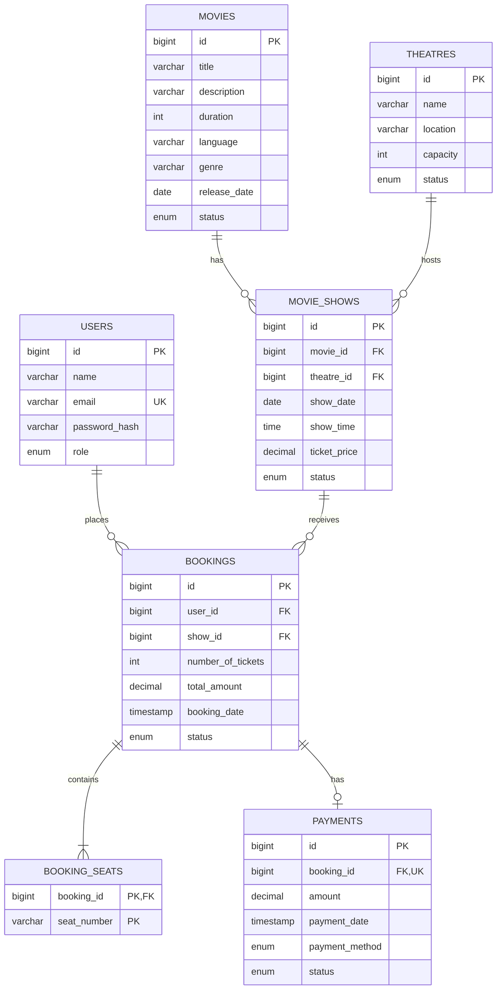

# Movie Ticket Booking Backend

CMJD 114/115 coursework: a REST API for managing movies, theatres, screenings, seat reservations, and simulated payments. The core domain contains exactly six entities: User, Movie, Theatre, Show, Booking, and Payment.

Start with [USER_GUIDE.html](USER_GUIDE.html) for installation, startup, sign-in, a complete booking demo, troubleshooting, and ZIP instructions. This is a backend API, not a graphical booking website.

## Technologies and architecture

- Java 21, Spring Boot 4.0.8, Maven 3.9.9 (included Maven Wrapper)
- Spring MVC, Spring Data JPA/Hibernate, MySQL 8+, Flyway migrations
- Spring Security, BCrypt passwords, signed JWTs with JJWT
- Bean Validation, centralized JSON errors, SLF4J logging
- JUnit, Mockito, MockMvc; H2 for local tests and a separate MySQL integration profile
- Lombok for entity accessors and constructor injection

```text
src/main/java/lk/ijse/moviebooking/
  controller/    REST endpoints and role authorization
  dto/           validated requests and safe response records
  service/       business rules and transactions
  repository/    JPA queries and pessimistic locks
  entity/        six persistent entities
  enums/         roles, lifecycle statuses, simulated outcomes
  security/      JWT verification, current account/role lookup, ownership
  config/        stateless security and optional administrator bootstrap
  exception/     consistent client-safe error responses
src/main/resources/db/migration/  versioned MySQL schema
src/test/                        local and MySQL verification
```

Controllers call services, services call repositories, and repositories access the database. Entities are never serialized directly. Catalog reads require authentication. A Theatre represents one screening space; multiple screens are future work.

## Prerequisites

1. Install a Java 21 JDK and set `JAVA_HOME` if Java is not already available.
2. Install/start MySQL 8+ (MySQL 8.4 LTS is recommended). MySQL Workbench is optional; it is not the database server.
3. Use PowerShell on Windows. Maven is downloaded automatically by `mvnw.cmd` on its first run; internet access is required for dependencies.

### Database setup

Run these statements in MySQL as a database administrator. Replace the example passwords with your own values; do not commit real credentials.

```sql
CREATE DATABASE movie_booking CHARACTER SET utf8mb4 COLLATE utf8mb4_unicode_ci;
CREATE USER 'movie_booking'@'localhost' IDENTIFIED BY 'replace-with-development-password';
GRANT ALL PRIVILEGES ON movie_booking.* TO 'movie_booking'@'localhost';

CREATE DATABASE movie_booking_test CHARACTER SET utf8mb4 COLLATE utf8mb4_unicode_ci;
CREATE USER 'movie_booking_test'@'localhost' IDENTIFIED BY 'replace-with-test-password';
GRANT ALL PRIVILEGES ON movie_booking_test.* TO 'movie_booking_test'@'localhost';
```

These grants are database-scoped, not server-wide. Give the test user access **only** to the test database. Flyway creates the tables on first startup; Hibernate validates them afterward. Do not manually import the migration and then run Flyway against that unmanaged schema.

### Project-local Windows setup

The helper scripts use the installed MySQL 8.4 binaries with a separate data directory under `.local/`. They do not install a Windows service or touch another MySQL data directory. MySQL binds only to `127.0.0.1:3306`; this setup uses application port 8081 because port 8080 may already be occupied.

If `.local/credentials.clixml` exists in this project directory, initialization is already complete; reuse it. Every fresh ZIP extraction or checkout needs its own setup. For a fresh checkout only, run `./scripts/Initialize-LocalMySql.ps1`, followed by `./scripts/Start-LocalMySql.ps1 -FirstStart` in a dedicated terminal. Initialization refuses to overwrite existing local data or credentials. After successful first startup and account verification, remove `.local/mysql-bootstrap.sql` using your file manager; it contains temporary plaintext setup credentials. Do not use `-FirstStart` again. An alternative MySQL install path or ports can be passed to the initialization script.

For subsequent sessions:

```powershell
# Terminal 1: start MySQL only if the project server is not already running.
.\scripts\Start-LocalMySql.ps1

# Terminal 2: load credentials into this process, then run all tests.
. .\scripts\Use-LocalEnvironment.ps1
.\mvnw.cmd verify -Pintegration

# Start the API with bootstrap disabled after the first administrator exists.
.\scripts\Start-LocalApp.ps1
```

Use `. .\scripts\Use-LocalEnvironment.ps1 -BootstrapAdmin` before the first application startup only. The helper generates a random administrator password for `admin@example.com`. Credentials are stored in `.local/credentials.clixml` using Windows DPAPI, readable only by the same Windows account on the same computer. `.local/` is Git-ignored and its directory permissions are restricted to that account. Never share it or commit a decrypted copy.

To sign in locally without printing the password or token:

```powershell
. .\scripts\Use-LocalEnvironment.ps1
$login = @{email=$localConfig.AdminEmail; password=(ConvertFrom-LocalSecret $localConfig.AdminPassword)}
$session = Invoke-RestMethod -Method POST -Uri "http://127.0.0.1:$env:PORT/api/auth/signin" -ContentType 'application/json' -Body ($login | ConvertTo-Json)
$headers = @{Authorization="Bearer $($session.token)"}
Invoke-RestMethod -Uri "http://127.0.0.1:$env:PORT/api/users" -Headers $headers
```

The helper connection settings disable TLS and permit RSA public-key retrieval **only for this loopback-only development instance**. Remote databases must use verified TLS. Load the environment again without `-BootstrapAdmin` after initial setup. Stop the application before stopping MySQL; Ctrl+C in each dedicated terminal shuts down its process. Do not rerun initialization to restart an existing server.

### Manual environment and first administrator

If you are not using the project-local helper scripts, set environment variables in the same PowerShell session used to start the app:

```powershell
$env:DB_URL = 'jdbc:mysql://localhost:3306/movie_booking'
$env:DB_USERNAME = 'movie_booking'
$env:DB_PASSWORD = 'your-development-password'

# Generate a random 256-bit signing key. Keep it private and stable between restarts.
$key = New-Object byte[] 32
$rng = [System.Security.Cryptography.RandomNumberGenerator]::Create()
$rng.GetBytes($key)
$rng.Dispose()
$env:JWT_SECRET = [Convert]::ToBase64String($key)

$env:ADMIN_BOOTSTRAP_ENABLED = 'true'
$env:ADMIN_NAME = 'Administrator'
$env:ADMIN_EMAIL = 'admin@example.com'
$env:ADMIN_PASSWORD = 'your-strong-admin-password'

.\mvnw.cmd spring-boot:run
```

The API listens at `http://localhost:8080`. Set `PORT` to change it. A `.env` file is not loaded automatically; use environment variables or an IDE run configuration. Neither database passwords nor the JWT key have an insecure default.

Bootstrap runs only when explicitly enabled and no administrator exists. It refuses to promote an existing customer with the same email. After the first successful startup, stop the app, set `ADMIN_BOOTSTRAP_ENABLED` to `false`, clear the bootstrap password from the run configuration, and restart. An administrator cannot delete or demote their own account. Run a single application instance during first-time bootstrap.

Sign up creates only CUSTOMER accounts. Sign in returns `token`, `tokenType`, `expiresIn` (3600 seconds), and user details. Supply `Authorization: Bearer <token>` on authenticated requests. JWTs reference user IDs; each request reloads the account and current role. Deleted accounts and changed roles take effect on subsequent requests. No refresh-token endpoint is included.

Passwords require at least eight characters and at most 72 UTF-8 bytes, including multibyte characters. Use HTTPS before exposing this backend outside localhost. The simulated processor is **not suitable for real money** and accepts a customer-selected result solely for demonstration.

### Build and run a packaged application

```powershell
.\mvnw.cmd verify
java -jar target/movie-booking-0.0.1-SNAPSHOT.jar
```

The same database and JWT environment variables are required by the packaged application. On macOS/Linux, use `sh ./mvnw` in place of `.\mvnw.cmd`. Java formatting can be checked with `.\mvnw.cmd spotless:check` or applied with `.\mvnw.cmd spotless:apply`.

### ZIP distribution

With the local MySQL server running, execute:

```powershell
.\scripts\Build-Distribution.ps1
```

The script runs formatting checks and `verify -Pintegration`, then creates a timestamped ZIP and SHA-256 checksum under `dist/`. It includes the verified runnable JAR (`app/movie-booking.jar`), source, tests, migrations, launch/setup/demo scripts, Maven Wrapper, README, and browser-readable user guide. An embedded manifest records hashes and test counts. ZIP contents are allowlisted and checked after creation; credentials, databases, logs, Git history, caches, and test-report XML are excluded. No MySQL or Java binaries are bundled.

Extract the ZIP to a normal writable folder before using it. Initialize a new project-local MySQL instance there as described in the guide, or configure an existing database manually. The extracted ZIP does not inherit this PC's accounts or database files. `Start-LocalApp.ps1` uses a locally rebuilt JAR if present, otherwise the bundled `app/movie-booking.jar`. Do not manually compress the entire workspace: Git ignore rules do not protect credentials in arbitrary ZIP tools.

## API endpoints

`Authenticated` means ADMIN or CUSTOMER; `Owner/admin` means the booking's customer or an administrator.

| Method | Path | Access / purpose |
| --- | --- | --- |
| POST | `/api/auth/signup` | Public; register CUSTOMER |
| POST | `/api/auth/signin` | Public; obtain JWT |
| GET | `/api/users` | ADMIN; list users |
| GET / PUT / DELETE | `/api/users/{id}` | ADMIN; read/update/delete user |
| GET | `/api/movies` | Authenticated; list movies |
| POST | `/api/movies` | ADMIN; create movie |
| GET | `/api/movies/{id}` | Authenticated |
| PUT / DELETE | `/api/movies/{id}` | ADMIN |
| GET | `/api/movies/{id}/shows` | Authenticated; screenings for a movie |
| GET | `/api/theatres` | Authenticated; list theatres |
| POST | `/api/theatres` | ADMIN |
| GET | `/api/theatres/{id}` | Authenticated |
| PUT / DELETE | `/api/theatres/{id}` | ADMIN |
| GET | `/api/shows` | Authenticated; list shows |
| POST | `/api/shows` | ADMIN |
| GET | `/api/shows/{id}` | Authenticated |
| PUT / DELETE | `/api/shows/{id}` | ADMIN |
| GET | `/api/shows/{id}/seats` | Authenticated; seat map and bookability |
| POST | `/api/bookings` | CUSTOMER; reserve seats |
| GET | `/api/bookings` | ADMIN; list all bookings |
| GET | `/api/bookings/my-bookings` | CUSTOMER; own bookings |
| GET | `/api/bookings/{id}` | Owner/admin |
| PUT | `/api/bookings/{id}/cancel` | Owner/admin; cancel before start |
| PUT | `/api/bookings/{id}/status` | ADMIN; enforce payment-backed lifecycle |
| POST | `/api/payments` | CUSTOMER; create own booking's payment |
| POST | `/api/payments/{id}/process` | CUSTOMER; simulate own payment result |
| GET | `/api/payments` | ADMIN; list all payments |
| GET | `/api/payments/{id}` | Owner/admin |
| GET | `/api/payments/{id}/status` | Owner/admin |

PUT requests supply the complete request DTO (see `dto/Requests.java`). User updates contain `name`, `email`, and `role`, never a stored password hash. All listing endpoints return arrays; pagination/search are intentionally deferred.

### Status values and rules

- User role: `ADMIN`, `CUSTOMER`.
- Movie: `UPCOMING`, `NOW_SHOWING`, `ENDED`. ENDED movies cannot receive new/rescheduled shows.
- Theatre: `ACTIVE`, `INACTIVE`. Inactive theatres cannot receive new/rescheduled shows. Capacity is 1–10,000 seats.
- Show: `SCHEDULED`, `COMPLETED`, `CANCELLED`. New shows must be future SCHEDULED screenings. Terminal shows cannot reopen; completion requires the end time to have passed.
- Booking: `PENDING`, `CONFIRMED`, `CANCELLED`. Both PENDING and CONFIRMED reserve seats. Unpaid reservations do not expire automatically in this core version.
- Payment: `PENDING`, `COMPLETED`, `FAILED`, `REFUNDED`. The sole method is `SIMULATED`; processing accepts only `COMPLETED` or `FAILED` as `outcome`.

Movie duration is 1–1,440 minutes; ticket price is LKR 0.01–999,999.99 with at most two decimal places. Screening times are local to `Asia/Colombo`; booking/payment timestamps are UTC instants. Totals use decimal arithmetic, not floating point. Each row has ten seats (`A1`–`A10`, `B1`–`B10`, continuing after `Z` as `AA`); the final row is limited by capacity. Seats are normalized to uppercase, duplicates are rejected, and ticket count must match.

Shows in a theatre cannot overlap, including across midnight; back-to-back shows are allowed. Scheduling locks movie records, then theatre records, then the show (ascending IDs within each group). Theatre locking serializes overlap checks. Duration changes are blocked while unfinished scheduled shows exist; capacity changes are blocked while scheduled shows exist. Screening details cannot change after any booking history exists. Status changes must be submitted separately from changes to screening details.

All booking/payment mutations lock their Show before loading mutable Booking/Payment entities. Connections use READ_COMMITTED isolation, so requests waiting on locks see committed changes. A seat-availability response is only a snapshot: clients must still handle HTTP 409 when submitting a booking. Never write reservations directly through SQL or another path that bypasses these service locks.

Payment creation derives the amount from the booking. Each booking has at most one payment; retry a FAILED payment using its existing ID. Successful processing atomically confirms the booking. Failed processing leaves it PENDING. Completed/refunded payments cannot be processed again. Canceled bookings and started/terminal shows cannot accept payments.

Customer/admin booking cancellation before show start releases seats; repeated cancellation is harmless. Pending payments become FAILED and completed payments become REFUNDED (simulated, without moving money). Administrator show cancellation applies those same rules to every active booking, including after the show has started. Referenced users, movies, theatres, and shows cannot be deleted; cancel/end them instead of deleting history.

### HTTP errors

Creation: 201; reads/updates: 200; deletion: 204. Invalid input: 400; missing/expired authentication: 401; forbidden action/ownership: 403; missing record: 404; seat, scheduling, lifecycle, or reference conflict: 409. Unexpected failures return 500 without internal exception details.

```json
{
  "timestamp": "2030-01-01T00:00:00Z",
  "status": 400,
  "error": "BAD_REQUEST",
  "message": "Request validation failed",
  "path": "/api/bookings",
  "fieldErrors": {"numberOfTickets": "must be greater than or equal to 1"}
}
```

## End-to-end sample requests

Start with an administrator created through bootstrap. For the project-local setup, `scripts/Test-LocalApi.ps1` performs a read-only connectivity/authentication check; add `-CreateDemo` to create and verify a complete booking/payment/refund example. Each demo run leaves clearly labeled sample records in the development database.

The following manual PowerShell requests also create demonstration records. Load the environment first so the correct port is selected. Replace example credentials for manual database setup. The API generates IDs; the script uses those returned values.

```powershell
# For project-local setup, first run: . .\scripts\Use-LocalEnvironment.ps1
$apiPort = if ($env:PORT) { $env:PORT } else { '8080' }
$base = "http://127.0.0.1:$apiPort/api"
function Send-Json($method, $path, $body, $headers) {
    $options = @{ Method=$method; Uri="$base$path"; Headers=$headers }
    if ($null -ne $body) {
        $options.ContentType = 'application/json'
        $options.Body = ($body | ConvertTo-Json -Depth 5)
    }
    Invoke-RestMethod @options
}

$adminLogin = if ($localConfig) {
    @{email=$localConfig.AdminEmail; password=(ConvertFrom-LocalSecret $localConfig.AdminPassword)}
} else {
    @{email='admin@example.com'; password='your-strong-admin-password'}
}
$admin = Send-Json POST '/auth/signin' $adminLogin @{}
$ah = @{ Authorization="Bearer $($admin.token)" }
$movie = Send-Json POST '/movies' @{
    title='Example Movie'; description='A coursework demonstration'; duration=120
    language='English'; genre='Adventure'; releaseDate='2026-01-01'; status='NOW_SHOWING'
} $ah
$theatre = Send-Json POST '/theatres' @{
    name='Colombo Cinema'; location='Colombo'; capacity=52; status='ACTIVE'
} $ah
$show = Send-Json POST '/shows' @{
    movieId=$movie.id; theatreId=$theatre.id
    showDate=(Get-Date).AddDays(7).ToString('yyyy-MM-dd'); showTime='18:00:00'
    ticketPrice=1250.50; status='SCHEDULED'
} $ah

Send-Json POST '/auth/signup' @{name='Sample Customer'; email='customer@example.com'; password='ExampleOnly123!'} @{}
$customer = Send-Json POST '/auth/signin' @{email='customer@example.com'; password='ExampleOnly123!'} @{}
$ch = @{ Authorization="Bearer $($customer.token)" }
Send-Json GET "/shows/$($show.id)/seats" $null $ch
$booking = Send-Json POST '/bookings' @{
    showId=$show.id; seatNumbers=@('A1','A2'); numberOfTickets=2
} $ch
$payment = Send-Json POST '/payments' @{bookingId=$booking.id; paymentMethod='SIMULATED'} $ch
Send-Json POST "/payments/$($payment.id)/process" @{outcome='COMPLETED'} $ch
Send-Json GET '/bookings/my-bookings' $null $ch
Send-Json GET "/payments/$($payment.id)/status" $null $ch
Send-Json PUT "/bookings/$($booking.id)/cancel" $null $ch
Send-Json GET "/payments/$($payment.id)" $null $ch
```

Expected: two seats cost LKR 2501.00; payment completion confirms the booking; cancellation changes the payment to REFUNDED and releases the seats. To demonstrate failure/retry, first process a new payment with `{"outcome":"FAILED"}`, then process that same payment with `{"outcome":"COMPLETED"}`. Use a different customer email or sign in to the existing account when repeating the sample.

## Entity relationship diagram



`BOOKING_SEATS` is an element-collection table owned by Booking, not a seventh JPA entity. Payment is optional until created, then its booking reference is unique. `payment_date` is null until a processing/cancellation event; after a refund it retains the original payment processing time.

## Tests and verification

```powershell
# Unit tests and full MockMvc/service workflows using in-memory H2:
.\mvnw.cmd test

# Add real MySQL migrations, Hibernate validation, and the same workflow/concurrency suite:
$env:DB_TEST_URL = 'jdbc:mysql://localhost:3306/movie_booking_test'
$env:DB_TEST_USERNAME = 'movie_booking_test'
$env:DB_TEST_PASSWORD = 'your-test-password'
.\mvnw.cmd verify -Pintegration
```

No development database/JWT configuration is required for local tests. Tests generate their own signing key and use a controlled clock. `application-test.yml` exists only under test resources; the packaged application cannot use it to fall back to H2.

The MySQL profile refuses to start unless both the database and username are `movie_booking_test`, and rejects reuse of the configured development URL/user. The dedicated MySQL user must have no grants on development/production databases. Tests create uniquely identified fixtures and retain test-only records; they never drop or clean a database. Run against a disposable test database, not business data.

Coverage includes role injection, expired/deleted-account tokens, changed roles, CRUD and validation, cross-customer access, price tampering, seat normalization/count/capacity, schedule overlap/midnight boundaries, protected history, payment failure/retry/refund, terminal shows, transaction rollback, simultaneous seat booking/scheduling/payment requests, and payment-cancellation races.

H2 results do not prove MySQL locking or migration compatibility. Real MySQL integration verification requires a running MySQL server and must pass before submission. Test reports are generated under `target/surefire-reports` and `target/failsafe-reports`.

Verified locally with MySQL 8.4.9: `verify -Pintegration` passed all 25 local tests and all 16 MySQL integration tests, with zero failures or skipped tests. Flyway applied V1 and Hibernate validated the schema in both the development and test databases. The test account was also denied access to the development database. Packaged-application startup, administrator sign-in, authorized user listing (200), and unauthenticated access rejection (401) were checked on port 8081.

The current Flyway dependency emits a warning that MySQL 8.4 is newer than its verified version; migrations and the integration suite nevertheless passed in this environment. This warning has not been suppressed.

## Future expansion proposal

### 1. Expiring seat holds

**Feature/usefulness:** reserve seats briefly during checkout and automatically release abandoned holds, avoiding indefinite PENDING reservations.

**Affected entities:** User, Show, Booking, Payment. **New entity:** SeatHold, with selected seats, creation/expiry time, and status. User 1:M SeatHold and Show 1:M SeatHold; a converted hold optionally references one Booking. Payment completion must validate the hold before confirmation. A scheduled cleanup and the booking transaction must coordinate expiry under the same show lock to prevent expiry/payment races.

### 2. Multiple screens and configurable seats

**Feature/usefulness:** represent real multiplexes with several screens, different row layouts, accessible seats, and seat categories.

**Affected entities:** Theatre, Show, Booking (and Payment if pricing becomes seat-category-based). **New entities:** Screen, Seat, and BookingSeat assignment. Theatre 1:M Screen; Screen 1:M Seat; Show M:1 Screen. Replace Booking's string collection with Booking 1:M BookingSeat and Seat 1:M BookingSeat. Each assignment refers to a Show and retains charged price; active show/seat uniqueness must be enforced transactionally. Schedule conflicts move from Theatre to Screen.

### Repository submission process

1. Finish the mandatory backend and run local plus MySQL integration tests.
2. Verify README instructions from a fresh checkout and confirm the ERD matches the migrations.
3. Initialize a local Git repository, review `.gitignore`, and ensure no credentials, database dumps, build output, or local IDE settings are staged.
4. Create an empty GitHub repository under your account. Commit milestone changes with meaningful messages, add the repository remote, and push the chosen branch.
5. Confirm the repository contains `README.md`, `.gitignore`, `pom.xml`, both Maven launchers, `.mvn/wrapper/maven-wrapper.properties`, sources, tests, and migrations.
6. Verify GitHub renders the ERD and proposal, provide access to the evaluator if the repository is private, and submit the actual GitHub repository URL.

A local Git repository is initialized on `main`, with no commits or remote configured. GitHub repository creation, commits, and pushes are separate user-authorized actions; no GitHub repository URL has been assigned by this implementation. Optional pagination, advanced search, MERN migration, real payments, refresh tokens, and password recovery remain outside the core scope.
